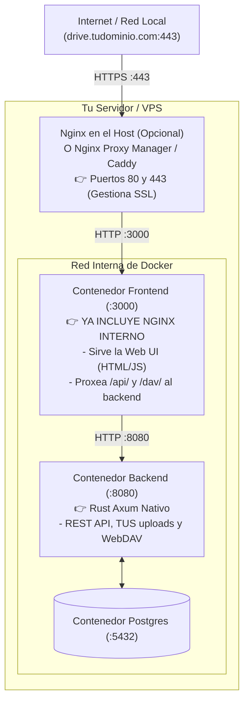

# Guía de Configuración de Proxy Inverso (Nginx, Caddy, Traefik, NPM)

Esta guía explica en detalle **dónde se ubica el proxy inverso** en OpenDrive y **cómo configurarlo paso a paso en todos los escenarios posibles** para exponer el servicio con tu propio dominio, certificado HTTPS/SSL y soporte completo para subidas de archivos gigantes y WebDAV.

---

## 1. ¿Dónde se establece Nginx? ¿En el Backend, en el Frontend o en los dos?

Para entenderlo de forma sencilla, hay que distinguir entre el **interior de Docker** y el **servidor físico/VPS**:



### La respuesta corta:
1. **Dentro del Frontend (Docker):** El contenedor del Frontend **ya incluye Nginx por dentro**. Ese Nginx interno se encarga de servir los archivos estáticos de React y reenviar automáticamente `/api/` y `/dav/` al contenedor del backend.
2. **En el Backend (Docker):** El backend **NO lleva Nginx**. Es un binario nativo en Rust (Axum) optimizado para alto rendimiento y concurrencia.
3. **En el Servidor / VPS (Proxy Inverso Frontal):** Si vas a usar un dominio con HTTPS (Let's Encrypt), **se coloca un Proxy Inverso DELANTE DE AMBOS**, en los puertos 80 y 443 del servidor.

---

## 2. Directivas Obligatorias para OpenDrive (¡Muy Importante!)

Cualquier proxy inverso que pongas delante de OpenDrive **debe tener estas directivas configuradas**, de lo contrario las subidas de archivos grandes fallarán o colapsarán la memoria RAM:

- **`client_max_body_size 0;`**: Desactiva el límite de tamaño de subida en Nginx (el control de cuota lo gestiona OpenDrive).
- **`proxy_request_buffering off;`**: **Vital.** Por defecto, Nginx descarga todo el archivo en su propio disco/RAM antes de pasárselo al backend. Al ponerlo en `off`, los chunks de subida (TUS) y los flujos WebDAV viajan en streaming directo al backend sin esperas ni uso excesivo de RAM.
- **`proxy_buffering off;`**: Permite descargas y streaming fluidos.
- **`proxy_read_timeout 3600s;`** y **`proxy_send_timeout 3600s;`**: Evita que subidas o descargas de archivos de muchos gigabytes se corten por timeout a los 60 segundos.

---

## 3. Configuración Paso a Paso según tu Caso

### CASO 1: Nginx instalado directamente en el Host (Ubuntu / Debian) con Certbot

Este es el caso más habitual si tienes un VPS o servidor Linux donde Docker corre OpenDrive y quieres usar Nginx del sistema operativo para gestionar el dominio y los certificados Let's Encrypt.

#### Paso 1: Instalar Nginx y Certbot
```bash
sudo apt update
sudo apt install -y nginx certbot python3-certbot-nginx
```

#### Paso 2: Crear el archivo de configuración del sitio
Crea el archivo `/etc/nginx/sites-available/opendrive`:
```bash
sudo nano /etc/nginx/sites-available/opendrive
```

Pega la siguiente configuración (sustituyendo `drive.tudominio.com` por tu dominio real):

```nginx
server {
    listen 80;
    server_name drive.tudominio.com;

    # Parámetros para archivos grandes y streaming
    client_max_body_size 0;
    proxy_request_buffering off;
    proxy_buffering off;
    proxy_read_timeout 3600s;
    proxy_send_timeout 3600s;

    # Todo el tráfico se envía al contenedor frontend de OpenDrive (puerto 3000)
    # El frontend ya se encarga de servir la web y proxiar /api/ y /dav/ al backend
    location / {
        proxy_pass http://127.0.0.1:3000;
        proxy_http_version 1.1;
        proxy_set_header Upgrade $http_upgrade;
        proxy_set_header Connection "upgrade";
        proxy_set_header Host $host;
        proxy_set_header X-Real-IP $remote_addr;
        proxy_set_header X-Forwarded-For $proxy_add_x_forwarded_for;
        proxy_set_header X-Forwarded-Proto $scheme;
    }
}
```

#### Paso 3: Activar el sitio y verificar la sintaxis
```bash
sudo ln -s /etc/nginx/sites-available/opendrive /etc/nginx/sites-enabled/
sudo nginx -t
sudo systemctl reload nginx
```

#### Paso 4: Obtener certificado SSL gratis con Certbot
```bash
sudo certbot --nginx -d drive.tudominio.com
```
Certbot configurará automáticamente el HTTPS, los certificados de Let's Encrypt y la redirección de HTTP a HTTPS.

#### Paso 5: Actualizar el `.env` de OpenDrive
En tu carpeta de OpenDrive, asegúrate de que `OPENDRIVE_PUBLIC_URL` coincida con tu nuevo dominio HTTPS:
```dotenv
OPENDRIVE_PUBLIC_URL=https://drive.tudominio.com
```
Reinicia los contenedores para aplicar el cambio:
```bash
docker compose up -d
```

---

### CASO 2: Nginx Proxy Manager (NPM con interfaz gráfica)

Si utilizas **Nginx Proxy Manager** (en Docker, CasaOS, Unraid, etc.):

1. Abre el panel de Nginx Proxy Manager (`http://IP_DEL_SERVIDOR:81`).
2. Ve a **Hosts** -> **Proxy Hosts** -> **Add Proxy Host**.
3. Pestaña **Details**:
   - **Domain Names**: `drive.tudominio.com`
   - **Scheme**: `http`
   - **Forward Hostname / IP**: La IP local de tu servidor (o el nombre del contenedor si comparten red Docker, ej. `opendrive-frontend`).
   - **Forward Port**: `3000`
   - Marca: **Block Common Exploits** y **Websockets Support**.
4. Pestaña **SSL**:
   - Selecciona **Request a new SSL Certificate**.
   - Marca **Force SSL**, **HTTP/2 Support** y **HSTS Enabled**.
   - Acepta los términos de Let's Encrypt.
5. Pestaña **Advanced** (¡Muy importante para subidas grandes!):
   Pega el siguiente bloque:
   ```nginx
   client_max_body_size 0;
   proxy_request_buffering off;
   proxy_buffering off;
   proxy_read_timeout 3600s;
   proxy_send_timeout 3600s;
   ```
6. Pulsa en **Save**.

---

### CASO 3: Caddy Integrado con Docker Compose (Automático y sin instalar nada)

OpenDrive ya incluye soporte nativo para **Caddy** en su `compose.yaml`. Caddy obtiene y renueva certificados SSL automáticamente sin necesidad de instalar Certbot.

#### Paso 1: Configurar el `.env`
Edita tu `.env`:
```dotenv
DOMAIN=drive.tudominio.com
ACME_EMAIL=tu-email@gmail.com
OPENDRIVE_PUBLIC_URL=https://drive.tudominio.com
```

#### Paso 2: Arrancar con el perfil TLS
```bash
docker compose --profile tls up -d
```
Caddy se levantará en los puertos 80 y 443, emitirá el certificado SSL con Let's Encrypt en cuestión de segundos y enrutará el tráfico hacia OpenDrive.

---

### CASO 4: Frontend y Backend en Servidores o IPs Diferentes

Si por ejemplo tienes el **Backend** en un servidor dedicado (`192.168.0.47:8080`) y el **Frontend / Nginx** en otra máquina o VPS:

Configuración de Nginx en el servidor frontal:

```nginx
server {
    listen 80;
    server_name drive.tudominio.com;
    return 301 https://$host$request_uri;
}

server {
    listen 443 ssl http2;
    server_name drive.tudominio.com;

    ssl_certificate /etc/letsencrypt/live/drive.tudominio.com/fullchain.pem;
    ssl_certificate_key /etc/letsencrypt/live/drive.tudominio.com/privkey.pem;

    client_max_body_size 0;
    proxy_request_buffering off;
    proxy_buffering off;
    proxy_read_timeout 3600s;
    proxy_send_timeout 3600s;

    # 1. Rutas del Backend: API REST, subidas TUS y WebDAV
    location ~ ^/(api|files|dav) {
        proxy_pass http://192.168.0.47:8080;
        proxy_http_version 1.1;
        proxy_set_header Host $host;
        proxy_set_header X-Real-IP $remote_addr;
        proxy_set_header X-Forwarded-For $proxy_add_x_forwarded_for;
        proxy_set_header X-Forwarded-Proto $scheme;
    }

    # 2. Ruta del Frontend: Interfaz Web visual
    location / {
        proxy_pass http://127.0.0.1:3000;
        proxy_http_version 1.1;
        proxy_set_header Host $host;
        proxy_set_header X-Real-IP $remote_addr;
        proxy_set_header X-Forwarded-For $proxy_add_x_forwarded_for;
        proxy_set_header X-Forwarded-Proto $scheme;
    }
}
```

---

### CASO 5: Cloudflare Tunnel (Sin abrir puertos en el Router / CG-NAT)

Si estás detrás de un CG-NAT o no puedes abrir los puertos 80/443 en el router de tu casa:

1. Instala `cloudflared` en tu servidor.
2. Inicia sesión y crea un túnel:
   ```bash
   cloudflared tunnel create opendrive
   ```
3. Configura el archivo `~/.cloudflared/config.yml`:
   ```yaml
   tunnel: <TUNNEL_ID>
   credentials-file: /home/usuario/.cloudflared/<TUNNEL_ID>.json

   ingress:
     - hostname: drive.tudominio.com
       service: http://localhost:3000
     - service: http_status:404
   ```
4. Asocia la ruta DNS en Cloudflare:
   ```bash
   cloudflared tunnel route dns opendrive drive.tudominio.com
   ```
5. Arranca el túnel como servicio:
   ```bash
   sudo cloudflared service install
   sudo systemctl start cloudflared
   ```
> [!NOTE]
> Cloudflare en su capa gratuita tiene un límite de subida por petición de 100 MB para tráfico HTTP estándar. Sin embargo, como OpenDrive utiliza el protocolo **TUS**, las subidas se realizan por trozos (chunks), permitiendo subir archivos más grandes sin superar el límite de petición de Cloudflare.

---

## 4. Diagnóstico y Comprobaciones

Una vez configurado tu proxy inverso, verifica que todo responda adecuadamente:

1. **Comprobar la cabecera HTTPS y el Healthcheck:**
   ```bash
   curl -I https://drive.tudominio.com/api/health
   ```
   *Debe responder `HTTP/2 200` o `HTTP/1.1 200 OK`.*

2. **Comprobar que WebDAV responde con desafío de autenticación:**
   ```bash
   curl -I https://drive.tudominio.com/dav/
   ```
   *Debe responder `HTTP/1.1 401 Unauthorized` con la cabecera `www-authenticate: Basic realm="OpenDrive"`.*

3. **Verificar los registros de Nginx si algo falla:**
   ```bash
   sudo tail -f /var/log/nginx/error.log
   ```
